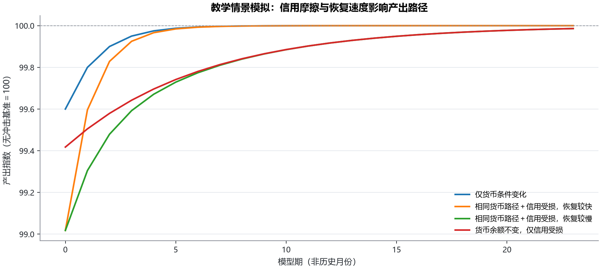
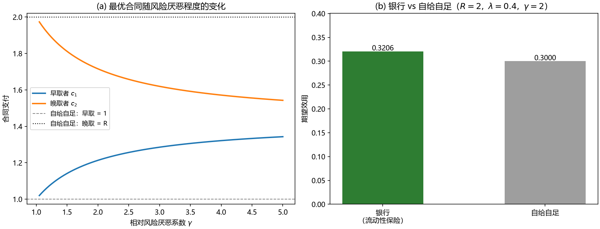
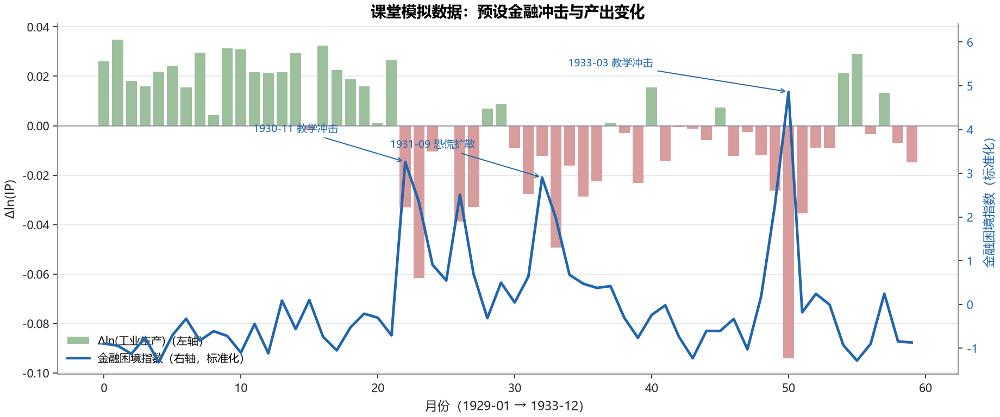
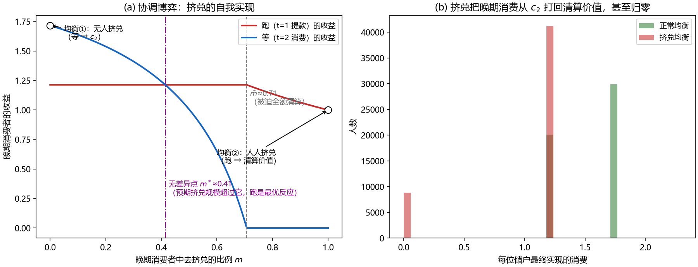
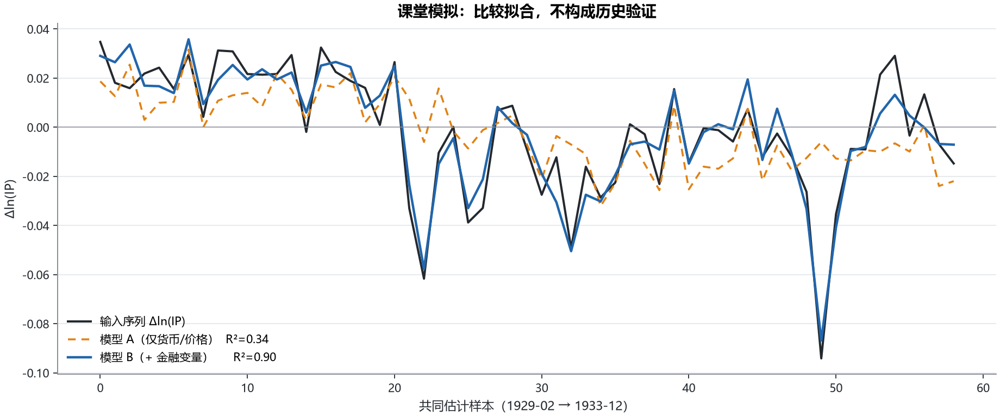
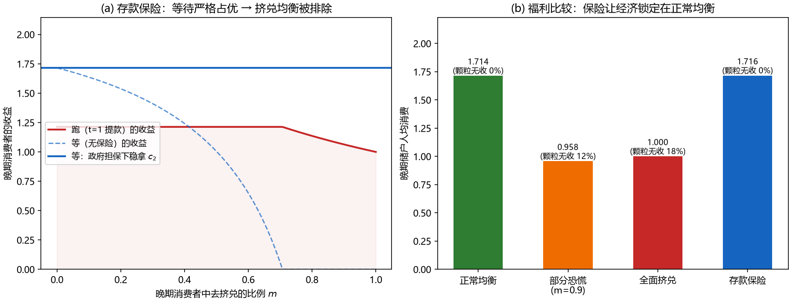

# Diamond–Dybvig (1983) 银行挤兑模型 & Bernanke (1983) 信用渠道

<div align="center">


**用 Python 展示经典银行机制，并补足到产出的宏观传导：**
**银行挤兑为什么自我实现，金融中介失灵为什么放大衰退。**

</div>

---

> 一句话分工：**Diamond–Dybvig 回答"银行为什么可能内生地突然失灵"；Bernanke 回答"金融中介失灵后，为什么会产生持续的宏观损失"。**


DD 解释这条链的第一环（脆弱性从哪来）。新增核心模块把持续性中介损失、融资成本、投资与简化 IS–LM 连起来；Bernanke 式回归单独保留为教学演示。

## 本次模型修订

详细的方程、主体、参数、假设、数据能力和可选扩展见 [模型说明](docs/model_architecture.md)。核心为：

`DD 额外清算 → 假设的中介损失 → 融资成本上升 → 投资下降 → IS–LM 产出响应`

额外清算到中介损失的接口是明示假设，不是 DD 原文推导；恢复系数不是历史估计。政策扩展仅比较给定提款下的流动性支持与净资产，未求解完整救助均衡。银行贷款数量约束与借款人净资产反馈仍属可选、未实现模块。

```bash
python macro_credit_model.py --output-dir results/core_model
python bernanke_1983.py --describe-csv data_1929_1933_real.csv --output-dir results/historical_description
python -m unittest discover -s tests -v
```

四个宏观情景及参数见 [结果与假设](results/core_model/assumptions_and_results.json)，原聊天附件的描述统计见 [历史数据文件核查](results/historical_description/historical_description.json)。CSV 保持原数值，不补造缺失回归变量；原稿将来源标为 FRED，本次只核对文件内部一致性，没有逐点在线验证来源。



## 互动网页（GitHub Pages · 点开即用）

| 模型 | 在线入口 | 能玩什么 |
|---|---|---|
| Diamond–Dybvig 挤兑模型 | **[dd-interactive.html](https://snowjqm-sys.github.io/diamond-dybvig-bernanke/dd-interactive.html)** | 调 R / λ / γ / m，看跑/等收益曲线与 m\*、m̄ 临界点，先到先得的银行账本，一键打开存款保险 |
| Bernanke 信贷渠道 | **[bernanke-interactive.html](https://snowjqm-sys.github.io/diamond-dybvig-bernanke/bernanke-interactive.html)** | 调银行受损 / 借款人困境 / 信息资本损失，看传导链、外部融资溢价与产出路径动画 |

> 两页为旧版「课堂重构」：参数是教学设定，不代表原文估计结果。

本次修订以脚本及结果文件为准；旧互动页面没有同步本次新增模型，不应视为修订版的数值复现入口。

## 核心结果一览

| | 结果 | 含义 |
|---|---|---|
| 最优合同 | c₁ = 1.213 > 1，c₂ = 1.716 | 早取保障高于清算价值，这就是**流动性保险** |
| 保险价值 | 期望效用 0.3206 vs 自给自足 0.3000 | 银行让每个人都过得更好 |
| 挤兑阈值 | m\* ≈ 0.41，m̄ ≈ 0.71 | 预期挤兑规模超过 m\*，"跑"成为最优反应 → **坏预期自我实现** |
| 挤兑演示 | 全面挤兑情景下约 17.6% 全体储户颗粒无收 | 给定参数的分配后果，不是历史宏观损失 |
| 模拟回归 | 共同样本 n=59；R² 0.345 → 0.904，调整R² 0.321 → 0.894 | 生成过程预设的作用被捕捉，不构成历史验证 |

## 图表

| DD 模型 | Bernanke 框架 |
|---|---|
|  |  |
| 最优合同与流动性保险的价值 | 预设金融冲击与产出变化（模拟数据） |
|  |  |
| 挤兑博弈的多重均衡 | 模型 A vs 模型 B 的拟合比较 |
|  | |
| 存款保险排除挤兑均衡 | |

## 快速开始

```bash
pip install -r requirements.txt
python dd_model.py        # DD 模型：数值结果 + 图 1~3
python bernanke_1983.py   # Bernanke 框架：回归表 + 图 4~5
```

## 文件结构

```
├── dd_model.py          # 最优合同、挤兑博弈（解析阈值 + 蒙特卡洛）、存款保险
├── bernanke_1983.py     # 回归框架（模型A/B比较），手写 OLS 含 t 检验
├── macro_credit_model.py # 持续性中介损失、融资成本与 IS–LM 教学情景
├── historical_data.py   # 附件 CSV 描述与完整性核对，不补造回归变量
├── data_1929_1933_real.csv # 原聊天附件副本，来源标签与核查边界见模型说明
├── docs/model_architecture.md # 核心方程、可选扩展与局限
├── results/             # 假设参数、情景 CSV、图形与描述性结果
├── tests/               # 市场恒等式、政策会计及数据边界检查
├── figures/             # 运行生成的 5 张图
└── requirements.txt     # numpy + matplotlib
```

## 接入真实数据

`bernanke_1983.py` 默认使用**课堂演示模拟数据**（参数由脚本显式设定），仅用于展示回归框架与读表方法。如需真实月度数据，从 [FRED](https://fred.stlouisfed.org) 下载整理后：

```bash
python bernanke_1983.py --csv your_data.csv
```

CSV 需含列：`date, dln_ip, money_growth, price_inflation, bank_distress, borrower_distress`。

当前附件只有 `date, ip, cpi, baa, dln_ip, inflation`，不能直接执行完整回归；请用 `--describe-csv`。完整 CSV 必须月度连续、数值有限，先整理完整样本；缺失值不以零或模拟数据填补。回归剔除没有已知滞后值的首期；模型 A/B 使用相同月份。普通 OLS 标准误与正态近似 p 值不构成正式时序稳健推断。

## 口径与表述边界（写论文前必读）

- 本仓库所有公式都是**课堂重构**，不冒充原论文逐字方程；模拟数据参数由脚本显式设定。
- 不要把 c₂>R、c₁<1<c₂ 写成无条件结论——精确数值取决于风险厌恶程度、早期消费者比例和合同形式。
- 模拟回归不能写成历史上的“支持信用渠道”证据：负向影响已写入生成过程。真实样本也需处理代理测量、内生性、结构变化及样本敏感性，不能仅据显著性和 R² 识别渠道。
- 基本 DD 的银行对应商业银行式存款中介，央行是额外政策主体；保险等待支付是外生承诺，代码没有政府预算、风险选择或内生道德风险。
- 宏观期、利率和货币余额均为教学单位；实际通胀不是预期通胀，Baa 收益率不是信用利差，INDPRO 不是 GDP。
- 把所有"导致"逐个检查是否有识别依据；CCI（信贷中介成本）只能用代理变量测量，且批准的贷款利率还存在选择偏差。

## 参考文献

- Diamond, D. W., & Dybvig, P. H. (1983). [Bank Runs, Deposit Insurance, and Liquidity](https://doi.org/10.1086/261155). *Journal of Political Economy*, 91(3), 401–419.
- Bernanke, B. S. (1983). [Non-Monetary Effects of the Financial Crisis in the Propagation of the Great Depression](https://doi.org/10.3386/w1054). *American Economic Review*, 73(3), 257–276. ([NBER w1054](https://www.nber.org/papers/w1054))
- Nobel Committee (2022). [Financial Intermediation and the Economy](https://www.nobelprize.org/prizes/economic-sciences/2022/advanced-information/)（诺贝尔经济学奖科学背景报告）
- Bernanke, B. S., & Gertler, M. (1995). [Inside the Black Box: The Credit Channel of Monetary Policy Transmission](https://www.nber.org/papers/w5146). *Journal of Economic Perspectives*, 9(4), 27–48.
- Brunnermeier, M. K. (2009). [Deciphering the Liquidity and Credit Crunch 2007–2008](https://www.nber.org/papers/w14612). *Journal of Economic Perspectives*, 23(1), 77–100.
- Calomiris, C. W., & Mason, J. R. (2003). [Consequences of Bank Distress During the Great Depression](https://doi.org/10.1257/000282803322157245). *American Economic Review*, 93(3), 937–947.

## License

MIT
